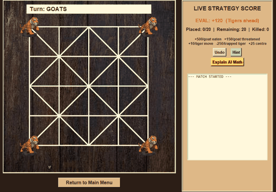
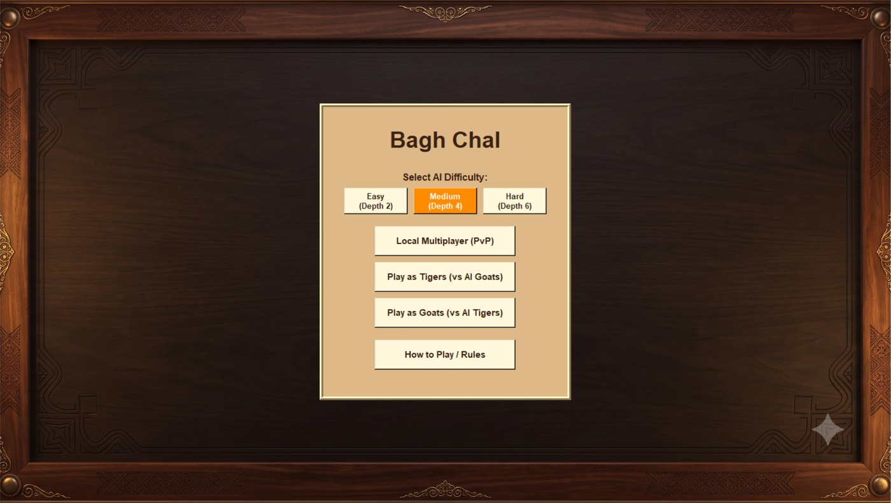
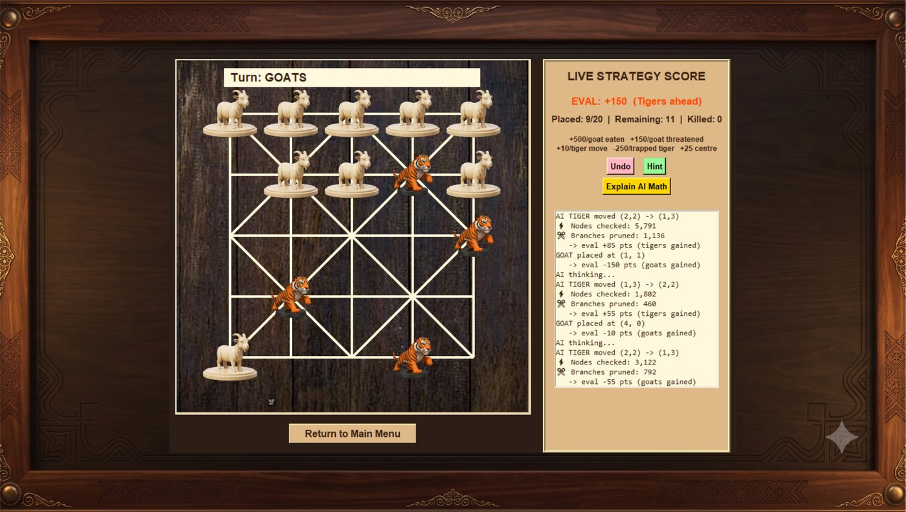

# Bagh Chal

[](https://github.com/brishabkc24/Bagh-Chal/actions/workflows/tests.yml)

[](https://github.com/brishabkc24/Bagh-Chal/releases/latest)

A desktop version of **Bagh Chal** (Tigers and Goats), the traditional Nepali
board game, written in Python with Tkinter. Play against another person on the
same computer or against a minimax AI with alpha-beta pruning.



| Main menu | Mid-game |
| --- | --- |
|  |  |

## Features

- **Local multiplayer** or **play as Tigers / play as Goats** against the AI
- Three AI levels: Easy (search depth 2), Medium (depth 4), Hard (depth 6)
- **Hint** button that asks the AI for the best move on your turn
- **Undo** (against the AI it takes back the reply and your move together)
- **Live strategy score** and an **Explain AI Math** window that shows the exact
  heuristic terms the search uses
- Move log with node and pruning counts for every AI move
- Threefold-repetition draw rule

## Quick start

No Python needed on Windows: grab `BaghChal.exe` from the
[latest release](https://github.com/brishabkc24/Bagh-Chal/releases/latest) and run it.

To run from source (Python 3.10 or newer; Tkinter ships with the standard installer):

```bash
pip install -r requirements.txt
python main.py
```

## Tests

```bash
pip install -r requirements-dev.txt
python -m pytest
```

The suite covers the rules engine (placement, moves, captures, win conditions,
threefold repetition, undo, simulate/undo round trips on thousands of random
positions) and the AI (move legality at every depth, capture preference,
heuristic consistency, a regression for a past freeze, and self-play). GitHub
Actions runs it on Python 3.10 to 3.13 for every push, then builds the Windows
executable with PyInstaller.

## How it works

- `board_logic.py` is the rules engine. A precomputed neighbour table encodes
  which points are joined by lines (diagonals only exist on even-sum points),
  so move generation never scans the board. It also keeps the undo stack and
  the position counts for the repetition rule.
- `ai.py` is a minimax search with alpha-beta pruning. Captures are searched
  first for tigers and edge placements first for goats, which improves cutoffs.
  Terminal scores carry the remaining depth so a nearer win is preferred.
- `gui.py` draws the board on a Tkinter canvas and runs the AI through
  `root.after`, so there is only ever one pending AI job and it is cancelled on
  Undo or on returning to the menu.

## Build the Windows .exe

```bash
python -m PyInstaller main.spec --noconfirm --clean
```

The single-file build appears at `dist\BaghChal.exe` with the images bundled,
so it runs from any folder. `dist` and `build` are ignored by Git; the .exe is
published through GitHub Releases.

## Project layout

| Path | Purpose |
| --- | --- |
| `main.py` | Main menu, difficulty selection, rules window, program entry point |
| `gui.py` | Tkinter board, click handling, Undo / Hint / Explain, move log |
| `board_logic.py` | Rules engine: moves, jumps, phases, win conditions, undo stack |
| `ai.py` | Minimax with alpha-beta pruning and the evaluation heuristic |
| `tests/` | pytest suite for the engine and the AI |
| `.github/workflows/tests.yml` | CI: tests on four Python versions, then the .exe build |
| `main.spec` | PyInstaller build definition |
| `docs/` | Screenshots and the demo GIF used above |
| `CORRECTIONS.md` | Changelog of bugs found and fixed during review |

## Rules in brief

- Four tigers start in the corners. Goats move first and place one goat per
  turn until all 20 are on the board, then goats move one step along a line.
- Tigers move one step along a line, or jump over an adjacent goat onto the
  empty point behind it to capture it. One capture per turn.
- **Tigers win** by capturing 5 goats, or if the goats have no legal move.
- **Goats win** by trapping all four tigers so none can move.
- The same position occurring three times is a draw.

## How the AI scores a position

Positive is good for the tigers. The weights live at the top of `ai.py`.

| Term | Weight |
| --- | --- |
| Each captured goat | +500 |
| Each goat a tiger can jump right now | +150 |
| Each legal tiger move | +10 |
| Each trapped tiger | -250 |
| Tiger on the centre point | +25 |
| Win / loss | +10000 / -10000, plus remaining depth so nearer wins are preferred |
